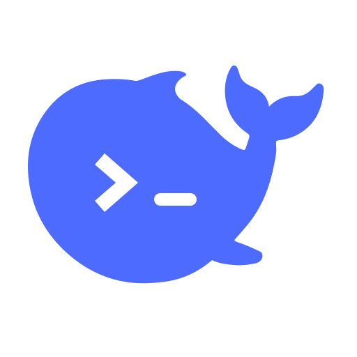

# Codex Model Patch

**Your models, in the original Codex.** Add existing cloud endpoints and local models to the native picker. Keep your login, history and tools, switch within one chat, and manage connections and patch updates in one settings window.

Unified **0.9.0** for macOS and Windows. Source and canonical update channel: `main`.
Updates download and verify ahead of time. One Start click queues installation until requests and tool work have settled; waiting is cancellable and expires after an hour while retaining the package. On the first upgrade from an older service without activity reporting, quit Codex normally to continue. Progress measures bytes or completed checks in the current stage. Startup failure restores the prior patch, and the final Launch Codex button confirms startup.


[中文](README.md) · [Architecture](docs/ARCHITECTURE.md) · [Validation](docs/VALIDATION.md) · [MIT](LICENSE)

## One edition, two platforms

DeepSeek, cloud interfaces and local models are optional connections in one product. Unconfigured services are not added automatically. Existing services continue to own subscription login and inference.

### Existing installations

Check for **0.9.0** in the current whale settings, or let enabled monitoring discover it. Each legacy DS/extension feed delivers one compatibility upgrade; subsequent checks use the single unified feed. An equivalent bridge and canonical package do not require a second installation of the same version.

Existing login, credential references, selected/hidden models, reduced context/compaction windows and maintenance preferences are retained. Existing service identities and directories remain for ownership and rollback, while the launcher becomes “Codex 模型设置”. Legacy feed URLs stay available for users who update later.

For manual installations without monitoring, prepare with the new source and the original build as `--baseline`, retain that build, then quit Codex normally before installation.

### First installation

Download and extract the source ZIP, or clone `main`. Python 3.11+ is required. From that directory run `python3 patch.py settings` on macOS or `python patch.py settings` in Windows PowerShell. Choose DeepSeek quick setup or a compatible/local interface, save and detect, prepare and verify, then quit Codex and install. Disconnect Codex in any existing model manager before installing this patch.

## Using DeepSeek after GPT quota is exhausted

This feature starts with DS **0.7.2** / extension **0.8.2-proxy.1**. Update the patch through your edition's channel first; versions 0.7.1 / 0.8.1-proxy.1 do not include this composer compatibility.

- **Normal use:** open Codex from its original icon. You do not need to use the patch settings each time.
- **If GPT's five-hour or weekly quota disables Send even after selecting DeepSeek:** save your work, fully quit Codex normally, then open it through the whale's **Preferences → Launch Codex** action. Select DeepSeek and send your message. The update completion page's **Launch Codex** button also uses this entry point.
- **Lifetime:** the compatibility remains active until that Codex process exits. Switching chats or models, or hiding the window, does not require another launch.
- **Later launches:** while GPT quota is still exhausted, use that entry point again. Fully quitting and opening the original icon restores the native composer behavior. Once GPT quota recovers, you can resume using the original icon.

The compatibility scopes the send-button quota lock to the selected model: explicitly registered independent services remain usable, while GPT keeps its own quota checks. The same rule applies to both editions on macOS and Windows. Official app files and signatures remain unchanged.

## Design

The official app stays unchanged: no ASAR edits, macOS re-signing, or copied Windows app. Windows retains its Store package identity and native updater. A small Python standard-library service listens only on loopback, forwarding GPT authentication to its original destination and using separate credentials for registered model services.

The built-in `openai` identity and native prediction request path are retained. Codex owns GPT stream deadlines, model selection, permissions, tools and compaction scheduling; external models generate readable handoffs through their own service. Switch models after the current reply completes. Provider-specific reasoning signatures are isolated across models; readable history and tool results remain available. Context defaults follow model maxima, while explicit reductions and hidden models are preserved.

When switching from older encrypted GPT compactions, the selected external model recovers a readable handoff. Truncated summaries split only the failing input and are cached after complete recovery. Quota, rate-limit, authentication and filtering failures receive distinct errors instead of a generic summary 502.

The extension supports Responses, Chat Completions and native Anthropic Messages. Select the protocol exposed by the service. Messages uses independent credentials, declared output limits and same-model thinking-signature round trips. Capabilities are declared by service metadata or configuration, not guessed from a vendor name. Unknown specifications do not receive arbitrary small context limits.

Python 3.11+ and the official macOS/Windows Codex app are required. No separate Node.js installation is required: older Python uses the untouched runtime bundled with Codex for native request compression. There is no resident management UI, database or model engine. A per-user system service runs the adapter; a separate scheduled monitor checks code/models and exits. Windows processes are windowless. Legacy code remains for recovery and regression, not new app modification.

Composer predictions follow the official client's feature gates, supported models, sampling and request deadline, and require an eligible completed chat with an empty composer. Native prediction requests and actual composer display are validated separately. Update windows are explicitly labeled **Codex Model Patch Update**, with the DS/extension channel; the official app retains its own updater.

## Connect and install

```sh
git clone --branch main https://github.com/limyum-creator/codex-deepseek-patch.git
cd codex-deepseek-patch
python3 patch.py connect --name local --kind ollama --url http://127.0.0.1:11434/v1
```

Use `--kind lmstudio` for LM Studio, or `--kind openai` for compatible services. Chat Completions endpoints require `--wire-api chat_completions`. Authentication can use `--key-file /absolute/path/key.txt`; no key is stored in the connection JSON. Select models with `--models ID1 ID2`. If metadata omits the maximum context, supply the actual model specification with `--context-window N` or `model_specs` in the connection file.

`--respect-server-context` preserves a smaller local server window without changing server settings. Enable `--supports-reasoning-effort` only for a Chat Completions service that accepts this field. `model_specs` can declare context, reasoning levels, input modalities and tool support.

```sh
python3 patch.py build --app /Applications/ChatGPT.app \
  --connections /absolute/path/connections.json --output /absolute/path/build --verify
# Quit Codex before activation:
python3 patch.py install /absolute/path/build
python3 monitor.py enable --app /Applications/ChatGPT.app --baseline /absolute/path/build
```

On Windows use `python`, Windows paths, and omit `--app` to discover the official installation. Existing EasyCLI/CLIProxyAPI can be selected with `--proxy-config /absolute/path/config.yaml` and optionally `--proxy-base-url`. Combine connections and proxy options as needed. DeepSeek is opt-in: `setup-key`, then build with `--with-deepseek`.


Verification uses the original CLI, isolated state and synthetic local endpoints in the background, without GUI launches or paid inference. Installation requires successful validation. For legacy migration, supply `--baseline`; on Mac point `--app` to its verified `original.app` backup and `--install-target` to the installed app. Only this first transition restores the official app.

Existing chats retain their native identity, content, archive state, model and reasoning preference. Old GPT compaction is recovered from locally verified readable records and summarized by the selected external model with its own credentials. **No GPT request or GPT quota is needed.** Shared fork history stops at the exact fork boundary; original files are not rewritten.

Existing handoff caches remain usable. Long records and oversized old summaries are reduced within the selected model's effective context. Missing, corrupt or unsupported local records produce an explicit recovery message instead of silent history loss. Summarization uses the selected service's quota.

## Native settings

Open **Codex Model Settings** from the user Applications folder on macOS or Start menu on Windows, or run `python3 patch.py settings`.

On the first upgrade, save and close an existing older settings window; the whale takes over afterward without discarding the open form.

A small draggable whale opens six compact water-drop categories: Models, Connections, Updates, Tools, Diagnostics and Preferences. Short hover hints and anchored cards share native styling. Drag near an edge to preview the docking spot; release to tuck into an edge-facing drop. The drop is white when no update is pending, pale red when attention is needed. Move away and return to peek; drag away to detach. Brief bubble sounds accompany deliberate opening and closing and can be disabled in Preferences. Manage visibility and context reductions, discover compatible endpoints, select models, configure image tools, compare capabilities, inspect/cancel history recovery, and copy redacted diagnostics.

Drag the whale to a screen edge to leave a small droplet. Hover to peek out, move away to tuck it back, or drag away to keep it floating. An open settings card stays visible while editing. Cards unfold from the selected drop with soft curved edges and staggered text; closing reverses the transition. Reduced motion switches directly between states.

Updates combines patch checks/retries, independent model synchronization, progress and launch actions. Cache cleanup, interrupted-install recovery and patch removal live under Updates → Maintenance. Right-click the whale to open Preferences, including appearance, motion, sound and the shortcut. Hide/show the on-demand UI with **Ctrl+Alt+D** (⌃⌥D on macOS); opening the App or Start menu entry again brings it back. Quitting the UI releases the shortcut. AppKit and WPF need no web server or additional UI runtime. Initial installation still uses the CLI.

## Integrated update progress

A new patch adds a small droplet beside the whale and tints the Updates button pale red. Background notifications reveal the badge without opening a settings card or taking focus. Click either entry to see the version and live progress in the same settings host. Closing the card or hiding the whale leaves the update running.

Start Update requests a normal Codex exit only after preparation and validation. Installation asks you to keep Codex closed. Completion restores the normal button color and offers Launch Codex without launching it automatically. Known work units show real counts; unknown-duration phases use an activity bar. Repeated checks do not repeatedly reveal the same notice. During a legacy upgrade, the integrated UI is available after the new components are downloaded. Future updates use one unified feed; legacy URLs are retained for migration.

## Maintenance

```sh
python3 monitor.py status
python3 monitor.py run-once --sync-now
python3 monitor.py model-options --model MODEL_ID --context-window 32768
python3 monitor.py model-options --model MODEL_ID --hide
python3 monitor.py model-options --model MODEL_ID --reset-context
python3 monitor.py disable
python3 patch.py recover /absolute/path/build
python3 patch.py restore /absolute/path/build
```

Code/model checks are independently configurable and edition-pinned. New Grok, Gemini Flash and Opus family versions are added while explicit exclusions remain. Installation waits for Codex to exit. Interrupted activation is recoverable. Restore reverses this adapter's configuration and keeps the official app; earlier legacy provider definitions are restored as recorded.

macOS privacy/keychain databases are not reset. Returning from a locally signed legacy app to the official identity may require one system permission confirmation; subsequent adapter updates do not re-sign the app.

Optional images: `python3 patch.py setup-images --proxy-config /absolute/path/config.yaml` uses existing CPA image endpoints through MCP. Model availability and account quotas belong to that service.

Unofficial project. Source only: never publish app bundles, extracted catalogs, personal configuration, credentials or raw user logs. See the validation document for real-model and synthetic coverage separately.

## Native cloud connectivity

Dot uses the official client's own cloud WebSocket. Repeated reconnects can come from system DNS or VPN/proxy routing even when HTTP requests through a system proxy work. The adapter does not silently change system DNS, disable a VPN or modify the official app. Use redacted diagnostics when reporting an issue.

## Repository layout

The root `patch.py` and `monitor.py` remain the public command entries. Implementation, internal tests and maintenance scripts live under [`src/`](src/); design and validation notes live in [`docs/`](docs/). Portable release packages preserve historical paths for existing automatic updaters. Source organization adds no runtime service. Model-only synchronization stages quietly and arms a temporary process-exit observer and applies after app exit; a fast relaunch safely defers installation; new code releases retain the update window.

Updates prefer one immutable source archive with exact per-file verification and retain the legacy download fallback. Explicit checks are queued behind busy work. Conservative cleanup protects active installations, recovery references and recent rollback artifacts. One unified package requires matching macOS/Windows receipts. Legacy migration bridges are generated once from that same core.

## Uninstall and restore native Codex

Save work and fully quit Codex. Use the whale's Update → Installation and recovery → Uninstall and restore native Codex, or run `python3 patch.py uninstall` from the source folder (Windows: `python patch.py uninstall`). Add `--dry-run` to inspect the detected target without changes. A build path is normally discovered automatically; custom installations can supply `--state-dir` or the retained `--build`. Ambiguous or independently managed configuration is preserved.

The command disables this patch's monitoring/adapter, removes unchanged owned launchers and managed image tools, restores owned configuration, and retains chats, login, credentials and recovery backups. It saves a pre-uninstall configuration copy. Repeat the same command to continue an interrupted restore. Do not delete the Codex data directory. External-model compatibility ends after removal; saved external chats remain readable, and a new GPT chat can use a readable handoff if native GPT cannot resume provider-private history.
